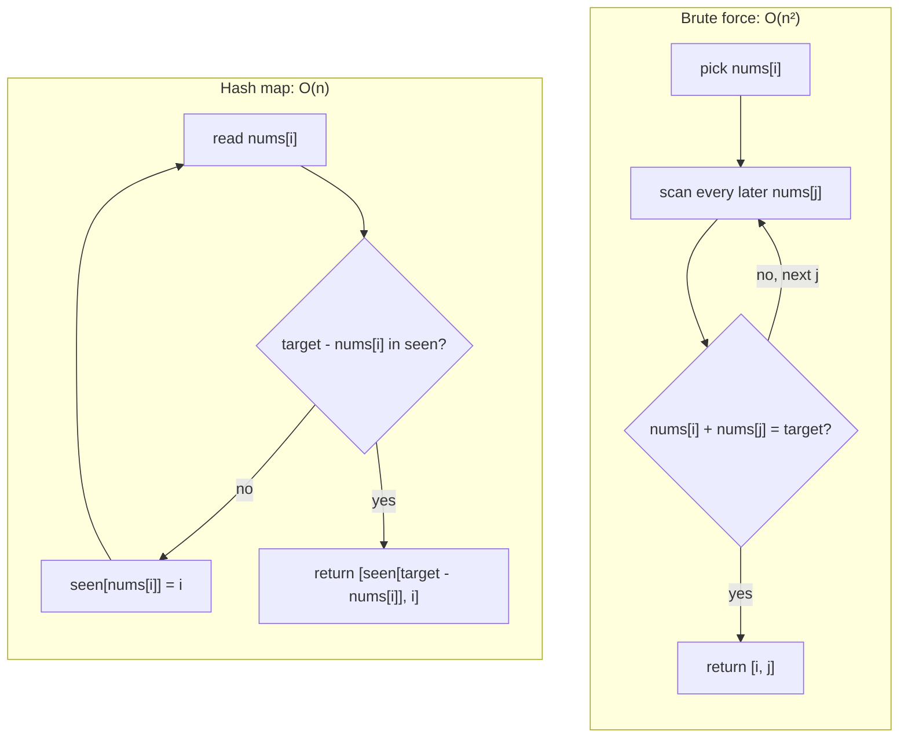
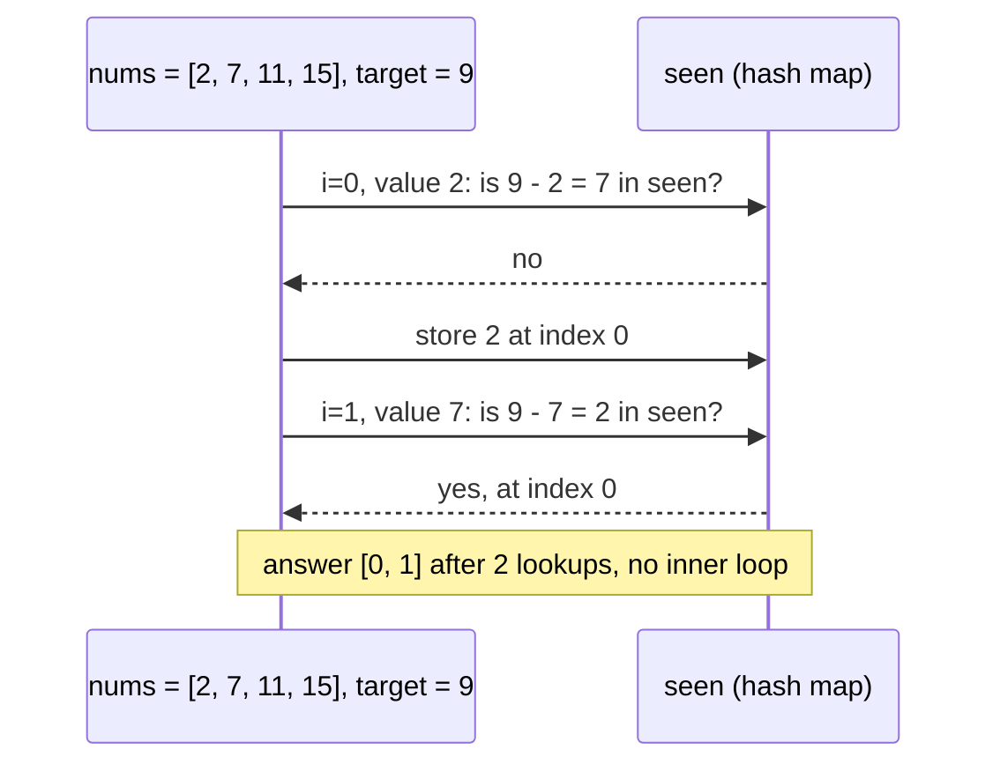

# 30-Day DSA Challenge — plan

Starts after Day 30 of the learning challenge. Same idea as before: one thing a day, predict first, build, measure,
write down what happened, and say plainly what was not measured. This time the "thing" is one DSA problem a day, and
the result is a brute force, a better solution, a measured difference in operations and time, and a Mermaid diagram of
why the better one does less work.

Choices made: 30 days, TypeScript, 90 minutes a day, one pattern and one problem a day, brute force first and then
the fix.

## What is the same and what changes

Same: predictions written by you before any code runs; `challenge.md` and `solution.md` per day; README row set to
"In progress" and then "Completed"; blog and LinkedIn post only when you ask; blog frontmatter with `draft: true`;
LinkedIn in prose with a `<link>` placeholder; no invented results; "not measured" is written down; you push git yourself.

Changes:

1. **You write both solutions.** For interviews the skill is writing the code yourself, so Claude does not write the
   brute force or the better solution. Claude writes the problem in its own words, the examples, the tests, the benchmark
   script and the first draft of the diagrams. If you are stuck for 20 minutes, ask for a hint, in three levels: (1) the
   name of the pattern, (2) the idea in one sentence, (3) pseudocode. Write the level you used in `solution.md`.
2. **Operations are counted, not only timed.** Milliseconds depend on the machine. Each solution adds one to a shared
   counter each time it does its basic step (a comparison, a lookup, a loop pass), so O(n²) against O(n) shows as a
   number you can check. Time is measured too, but the operation count is the main result.
3. **Mermaid diagrams.** See below.
4. **Interview wording.** `solution.md` has a section where you explain the solution in 3 sentences as you would to an
   interviewer, and a list of edge cases you would ask about.
5. **"Same pattern, other problems" remark.** Every `solution.md` and every blog post ends its main part with a short
   remark so that readers (and you, in an interview) can recognize the pattern in a different problem. See the next
   section.

## The pattern remark (in every solution and every blog post)

Four short parts, all about the pattern and not only the day's problem:

1. **How to spot it.** One sentence with the signal in the problem text. Example for sliding window: "a contiguous
   subarray or substring, plus a condition that can be checked as the window grows and shrinks."
2. **Other problems that use it.** 3 to 5 well-known problems by name, each with the one-line twist (what changes
   compared with today's problem). For example, for the variable sliding window: longest substring with at most k
   distinct characters, minimum size subarray with a sum of at least a target, longest run of ones if you may flip k zeros.
3. **Where it is used outside interviews.** 1 or 2 real uses, described as where the idea is used, not as a claim about
   how a particular company built it. Example for the sliding window: a sliding-window rate limiter counts the requests
   whose timestamps fall inside the last N seconds, and the window start moves forward as time moves; rolling averages
   and "peak in the last 5 minutes" in monitoring are the same shape.
4. **What I have solved.** Next to each related problem, mark "solved" or "not solved" (and the date if solved). Only
   mark "solved" for problems you really solved. The list is a map for the next practice, not a claim.

Who writes it: Claude drafts the first three parts (the plan below has a starting map for all 30 days); you check
them, change what is wrong, and add one problem or use from your own experience. In the blog post, the remark is written
in your voice, and the draft by Claude is not presented as something you checked unless you did. The related-problem
names are common names; the problem text is never copied.

Blog layout for each post: the problem in my own words, brute force, the fix (flow diagram as an image), the trace
(second diagram), measured numbers (a table), the pattern remark, what I did not measure, what's next.

## Day template

```
day-NN-<problem-name>/
  challenge.md          problem in own words, 3 examples, predictions, steps  (Claude writes)
  solution.md           your predictions, output, explanation, not measured   (you fill in, Claude records pasted output)
  src/
    brute.ts            you write
    better.ts           you write
    tests.ts            Claude writes; compares brute and better on fixed and random inputs
    bench.ts            Claude writes; counts operations, times, 3 sizes
  diagrams/
    flow.mmd            Mermaid source (Claude drafts, you check it matches your code)
    trace.mmd
    flow.svg            rendered picture for the blog
```

Shared files at the repo root (written once on day 1): `package.json` (with `tsx` and `typescript`; your Node is
v22.2.0, which cannot run TypeScript directly, so `npx tsx` runs the files), `shared/ops.ts` (the counter),
`shared/random.ts` (a seeded random generator, so every run uses the same inputs), `shared/bench.ts`.

The 90 minutes:

| Minutes | Step |
|---------|------|
| 5 | Predictions in `solution.md` (before reading anything else): the time complexity of your brute force, how many operations at n = 1,000, and your guess for the better solution. |
| 30 | Part A: write `brute.ts`, run `tests.ts` until it passes. |
| 30 | Part B: write `better.ts`, run `tests.ts` (brute and better must give the same answers), then `npx tsx src/bench.ts`. |
| 25 | Notes: paste the output, interview explanation, edge cases, Mermaid check, not measured. |

`solution.md` template: Predictions, Output (bench table), Hint level used, Interview explanation (3 sentences),
Edge cases I would ask about, Diagram check (does the diagram match my code?), Same pattern, other problems (how to
spot it, related problems with solved / not solved, where it is used), Not measured / still open, Link.

Benchmark rules: the sizes are chosen per problem (usually 1,000, 10,000 and 100,000). If the brute force would take
more than about 10 seconds, the script skips it and prints "not run", and you write that down. Both solutions must
return the same result on every input, or the benchmark stops.

## Mermaid diagrams

Each day has two diagrams, drawn from your solution and not from a textbook:

1. **Flow** (`flowchart`): the brute force and the better solution side by side, so you can see the inner loop that
   disappears.
2. **Trace** (`sequenceDiagram` or a `flowchart`): the first example from `challenge.md` run step by step through the
   better solution (what is in the hash map, where the pointers are, what is on the stack).

Rules:

- Claude drafts them and renders them to check the syntax; you check they match your code, and write "diagram checked"
  or what is wrong in `solution.md`. A diagram that does not match the code is a bug.
- GitHub shows a ```` ```mermaid ```` block as a picture inside `.md` files. Your blog does not: it uses `remark`,
  `remark-gfm` and `remark-html`, which would show the block as plain code. So for blog posts the diagram is rendered
  to an SVG (`mmdc`, Mermaid's command line tool) and added to the post as an image. The `.mmd` source stays in the
  repo. Putting Mermaid support directly into the blog is possible later, but it is a change to ch-ai.in, not to this
  challenge.
- A chart of measured operations goes in only with real numbers from your bench output. A table does the job just as well.

Example for Day 1 (Two Sum). I checked that both render.

Flow:



Trace (nums = [2, 7, 11, 15], target = 9):



The sentence the diagram should make obvious: the brute force asks "which later number completes me?" by scanning,
and the hash map answers the same question with one lookup, paid for with O(n) extra memory.

## The 30 days

"Brute" is the first solution you write, "better" is the target. Complexities are the usual textbook ones; the bench
checks whether the operation counts really look like that. Problem names are the common ones; the problem text is
written fresh in each `challenge.md`.

| Day | Pattern | Problem | Brute | Better |
|-----|---------|---------|-------|--------|
| 1 | Hash map | Two Sum | O(n²) | O(n) |
| 2 | Hash set | Longest Consecutive Sequence | O(n log n) sort | O(n) |
| 3 | Hash map as a key | Group Anagrams | O(n · k log k) | O(n · k) |
| 4 | Prefix sum + hash map | Subarray Sum Equals K | O(n²) | O(n) |
| 5 | Prefix and suffix | Product of Array Except Self | O(n²) | O(n) |
| 6 | Sort + two pointers | 3Sum | O(n³) | O(n²) |
| 7 | Two pointers | Container With Most Water | O(n²) | O(n) |
| 8 | Two pointers | Trapping Rain Water | O(n²) | O(n) |
| 9 | Fixed sliding window | Maximum sum of a subarray of size k | O(n · k) | O(n) |
| 10 | Variable sliding window | Longest Substring Without Repeating Characters | O(n²) or more | O(n) |
| 11 | Sliding window | Longest Repeating Character Replacement | O(n²) | O(n) |
| 12 | Monotonic deque | Sliding Window Maximum | O(n · k) | O(n) |
| 13 | Stack | Valid Parentheses | O(n²) repeated removal | O(n) |
| 14 | Monotonic stack | Daily Temperatures | O(n²) | O(n) |
| 15 | Monotonic stack | Largest Rectangle in Histogram | O(n²) | O(n) |
| 16 | Binary search | Search in Rotated Sorted Array | O(n) | O(log n) |
| 17 | Binary search on the answer | Koko Eating Bananas | O(n · max) | O(n log max) |
| 18 | Heap / bucket | Top K Frequent Elements | O(n log n) | O(n log k) or O(n) |
| 19 | Heap | Kth Largest Element | O(n log n) | O(n log k) |
| 20 | Fast and slow pointers | Linked List Cycle | O(n) time, O(n) memory | O(n) time, O(1) memory (a memory day, not a time day) |
| 21 | Tree recursion with bounds | Validate Binary Search Tree | O(n²) | O(n) |
| 22 | Tree recursion, return two things | Diameter of Binary Tree | O(n²) | O(n) |
| 23 | Union-Find | Redundant Connection | O(E · (V + E)) | about O(E) |
| 24 | Topological sort | Course Schedule | O(V · (V + E)) | O(V + E) |
| 25 | Memoization | Climbing Stairs | O(2ⁿ) | O(n) |
| 26 | Dynamic programming | House Robber | O(2ⁿ) | O(n), then O(1) memory |
| 27 | Dynamic programming | Coin Change | exponential | O(n · amount) |
| 28 | DP + binary search | Longest Increasing Subsequence | O(n²) | O(n log n) |
| 29 | Trie | Implement Trie / prefix search | O(n · L) per query | O(L) per query |
| 30 | Hash map + doubly linked list | LRU Cache (capstone) | O(n) per operation | O(1) per operation |

Notes on the table:

- Days 20 and 30 are about memory and constant-time operations, so their predictions and charts are about memory and
  operations per call, and the template adjusts for that.
- Day 25 to 27 brute forces are exponential. The bench caps n at a size where the brute force still finishes (for
  example n = 20, 25, 30) and says so.
- If a day's problem turns out to be a poor fit (too easy, or the brute force is the textbook answer), swap it for
  another problem of the same pattern and write the swap in the README. Do not stretch a day.

## Starting map for the pattern remark (Claude's draft, to be checked by you)

Related problems are well-known names. "Signal" is what in the problem text should make you think of the pattern.

| Day | Signal in the problem | Other problems with the same idea | Where it is used |
|-----|-----------------------|-----------------------------------|------------------|
| 1 | "find two items that fit together", a partner can be computed | Two Sum II (sorted input, so two pointers), 4Sum II, pairs with a given difference | Joining two datasets on a key (a hash join in a database), matching payments to refunds |
| 2 | "does it exist" or "streak" over unordered data | Contains Duplicate, Missing Number, Intersection of Two Arrays | Removing duplicates in a pipeline, counting consecutive-day streaks |
| 3 | Items are "the same" after some normalization | Valid Anagram, Find All Anagrams in a String, Isomorphic Strings | Grouping records by a normalized key (emails, product names) before comparing |
| 4 | Sum of a contiguous range, "how many ranges" | Continuous Subarray Sum, Contiguous Array, Range Sum Query | Totals for any date range from one running total, time-series analytics |
| 5 | "everything except me", values from both sides | Best Time to Buy and Sell Stock, Trapping Rain Water (prefix and suffix maximum) | Running totals and normalizations that need the left and the right context |
| 6 | Sorted input or sortable, several values add up to a target | Two Sum II, 3Sum Closest, 4Sum | Merging two sorted lists, finding combinations that fit a budget |
| 7 | Two ends of a sorted or bounded structure, move the worse end | Valid Palindrome, Squares of a Sorted Array, Two Sum II | Narrowing a search from both ends when one end can be ruled out |
| 8 | Each position depends on the best on its left and on its right | Container With Most Water, Product of Array Except Self, Candy | Capacity between boundaries, a simple elevation or terrain model |
| 9 | Fixed-size contiguous range moving along the data | Maximum Average Subarray I, Find All Anagrams in a String, Permutation in String | Moving averages, fixed-window counters in a rate limiter, rolling metrics |
| 10 | Longest or shortest contiguous range under a condition | Longest Substring with At Most K Distinct Characters, Minimum Size Subarray Sum, Fruit Into Baskets | A sliding-window rate limiter (requests in the last N seconds), longest run without an error |
| 11 | A window that may break the rule a limited number of times | Max Consecutive Ones III, Longest Substring with At Most K Distinct Characters | Longest stretch of readings allowing up to k bad ones |
| 12 | Maximum or minimum of every window | Sliding Window Minimum, Shortest Subarray with Sum at Least K, Jump Game VI | "Peak latency in the last N minutes", highest price in the last k days |
| 13 | Nested or paired structure, last opened is first closed | Evaluate Reverse Polish Notation, Decode String, Min Stack, Simplify Path | Parsers and compilers, bracket matching in editors, undo history |
| 14 | "next greater" or "next smaller" element | Next Greater Element I and II, Online Stock Span, Remove K Digits, Asteroid Collision | Days since a higher price, next event above a threshold |
| 15 | How far each element can extend as the minimum or maximum | Maximal Rectangle, Sum of Subarray Minimums, Trapping Rain Water (stack version) | Skyline and histogram analysis, largest empty block in a layout |
| 16 | Sorted or partly sorted data, one half can be ruled out | Find Minimum in Rotated Sorted Array, First and Last Position of an Element, Find Peak Element | Lookups in sorted indexes, `git bisect` to find the change that broke something |
| 17 | "smallest value that is enough", and checking one value is easy | Capacity to Ship Packages Within D Days, Split Array Largest Sum, Minimum Number of Days to Make Bouquets | Capacity planning (the smallest speed or size that meets a deadline), tuning a threshold |
| 18 | "top k" or "most frequent" | Top K Frequent Words, K Closest Points to Origin, Merge k Sorted Lists | Trending lists, leaderboards, ranking suggestions |
| 19 | "kth" item of a large or streaming input | Kth Largest Element in a Stream, Find Median from Data Stream, Last Stone Weight | Streaming top-k, priority queues in schedulers, a running median of latencies |
| 20 | A pointer chain that may loop | Linked List Cycle II, Middle of the Linked List, Find the Duplicate Number, Happy Number | Detecting loops in linked structures, finding the middle without knowing the length |
| 21 | A property that depends on the whole subtree or on ancestors | Same Tree, Symmetric Tree, Kth Smallest Element in a BST | Validating hierarchical data and range constraints |
| 22 | A tree answer that combines the answers of both children | Binary Tree Maximum Path Sum, Balanced Binary Tree, House Robber III | Totals computed bottom-up in hierarchies (folder sizes, org charts) |
| 23 | "are these connected", groups that merge over time | Number of Connected Components, Accounts Merge, Graph Valid Tree, Kruskal's minimum spanning tree | Network connectivity, merging duplicate accounts or records, connected regions in an image |
| 24 | "do this before that", dependencies | Course Schedule II, Alien Dictionary, Parallel Courses | Build systems, package managers, CI pipeline ordering, ordering of migrations |
| 25 | The same subproblem is computed again and again | Fibonacci Number, Min Cost Climbing Stairs, Decode Ways | Memoizing pure functions, caching repeated sub-results |
| 26 | At each item choose "take it" or "skip it", with a conflict rule | House Robber II, Delete and Earn, Maximum Subarray, Best Time to Buy and Sell Stock with Cooldown | Choosing non-conflicting items for the most value |
| 27 | "fewest items that add up to a target", items can repeat | Coin Change II, Perfect Squares, Minimum Cost For Tickets | Making change, the fewest packages that reach a quantity |
| 28 | The best sequence ending at each position, sequences are ordered | Russian Doll Envelopes, Longest Common Subsequence, Edit Distance | Diff tools (longest common subsequence), comparing versions |
| 29 | Many lookups by prefix over a set of strings | Design Add and Search Words, Word Search II, Replace Words, Longest Common Prefix | Autocomplete, spell check, longest-prefix match in routing tables |
| 30 | Fast lookup plus fast "remove the oldest or least used" | LFU Cache, Design Browser History, All O(1) Data Structure | Caches in browsers and databases; the TTL cache module you described is a close relative |

## Starting the challenge

When you say "start today's challenge" for DSA Day 1, Claude will:

1. Create the repo folder `30-day-dsa-challenge/` on your computer (you create the GitHub repository and push yourself),
   with `README.md` (a table like the current one), `package.json`, the `shared/` files and `day-01-two-sum/`.
2. Write `challenge.md`, `tests.ts`, `bench.ts` and the Mermaid drafts for Day 1, and render the diagrams to SVG.
3. Ask for your three predictions, and nothing else, before you write code.

Questions that are still open, and can wait until Day 1:

- A new repository (recommended: `30-day-dsa-challenge`), or a folder inside the current one?
- Whether the Mermaid diagrams should also be added to the blog itself later (a change to ch-ai.in).
- Whether you want a LinkedIn post and blog for every day, as before, or only for the days you choose.
